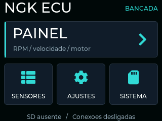
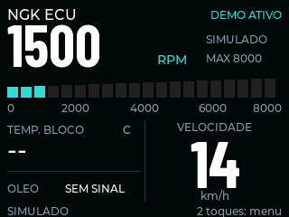
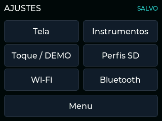

# NGK ECU

Projeto experimental de painel e futura ECU para um motor boxer Volkswagen
Fusca **1300 carburado**, de ano desconhecido, em uma gaiola de uso fora de
estrada, usando ESP32 com tela touch.
Referência funcional: instrumentos e configuração na própria tela, como em
painéis de gerenciamento de motor. Interface e firmware serão próprios.

## Primeira etapa

| Medição | Unidade | Informação ainda necessária |
| --- | --- | --- |
| Rotação do motor | RPM | Origem do sinal, níveis elétricos e pulsos por volta |
| Temperatura do bloco | °C | Sensor, ponto de instalação e calibração |
| Velocidade do veículo | km/h | Sensor, pulsos por volta e circunferência da roda |

Armazenamento em cartão microSD de 32 GB, preparado e verificado em FAT32
pela própria placa. Incluir os sensores e sinais originais que
efetivamente existem nesse motor, conforme o [inventário](docs/sensores-motor.md).
Mapas de combustível, injeção **monoponto**, ignição e outras
automações pertencem a etapas futuras, com projeto elétrico e validação próprios.

Substituição do firmware e manutenção/formatação do SD pela própria placa
foram autorizadas. Não é necessário um leitor externo para o fluxo escolhido.

## Estado atual

- Firmware próprio de bancada em [firmware/ecu](firmware/ecu/README.md), com
  menu de quatro botões, sete páginas de ajustes e instrumentos `-- / SEM SINAL`. Nenhum sensor/atuador externo
  está habilitado. A aplicação de referência não é o produto da ECU.
- Foto indica a família **ESP32-2432S028**; revisão e pinagem pendentes de confirmação.
- Consulta USB confirmou **ESP32-D0WD-V3 rev. 3.1, flash de 4 MiB** e ponte CH340.
  Backup local completo conferido antes de gravar manutenção temporária.
- Um cartão reportou **1.898 MiB**, divergindo dos 32 GB informados; a trava
  impediu formatação. O responsável retirou esse cartão e informou ter colocado
  o correto. A consulta nova confirmou **30.255 MiB**; esse cartão foi preparado
  em FAT32 e passou por escrita/leitura de arquivo próprio temporário.
- REA 6.8.0 e esptool 5.6.0 instalados localmente e com versões verificadas.
  Análise do ELF próprio executada com objdump via REA; não houve
  descompilação Xtensa.
  Instalar a ferramenta não identifica automaticamente tela ou GPIOs.

## Documentação

- [Escopo e próximos marcos](docs/escopo.md)
- [Inventário de hardware e pendências](docs/hardware.md)
- [Ferramentas e REA](docs/ferramentas.md)
- [Validação e bloqueios observados](docs/validacao.md)
- [Sensores do motor 1300 carburado](docs/sensores-motor.md)
- [Referência visual e limites de desempenho](docs/interface.md)
- [SD, memória e otimizações](docs/armazenamento-e-desempenho.md)

## Liberar a serial nesta conexão Linux

A porta atual é `/dev/ttyUSB0` e o sistema dispõe de `setfacl`. Executar no
terminal do operador, com autorização administrativa:

```sh
sudo setfacl -m "u:$(id -un):rw" /dev/ttyUSB0
```

A ACL dá leitura/escrita ao usuário atual sem exigir nova sessão ou mudança
de grupo. Vale para o dispositivo desta conexão; ao reconectar, conferir o
nome da porta e repetir se necessário. Não compartilhar senha com o agente.
Se essa conta não estiver no sudoers, a liberação deve ser feita por uma conta
administradora, usando o UID da sessão original como destino. Não substituir
por `id -u` já dentro da conta administradora, pois daria acesso ao usuário errado.
O comando não concede privilégio administrativo à conta do agente.

## Limites de validação

O painel começa sem saídas de atuação. Não conectar sinal de bobina, rede de
12 V ou sensor de tensão desconhecida diretamente ao ESP32. São necessários
condicionamento de sinais e alimentação adequada ao ambiente veicular.
Montagem USB em bancada não valida operação no veículo.

A versão **0.3.0-cockpit** foi instalada em bancada: cockpit assimétrico, RPM
em barra crescente, números condensados grandes, índice de ajustes, perfis SD e
Wi-Fi/BLE sob demanda. Os rádios começam desligados. A memória desta unidade
limitou a ativação simultânea: usar um por vez; a interface informa recusa.

Doze executáveis nativos, doze testes de fonte e três builds passaram.
Medição própria sintética: **57,6 apresentações parciais/s**, p95 de **17,1 ms**;
com busca Wi-Fi ou anúncio BLE separado, cerca de 57,5–57,6/s. Não são telas completas
por segundo nem medição óptica. Relatório e limites em [validação](docs/validacao.md).
Sensores, atuação e uso no veículo continuam sem validação.

Renderizações do próprio código com LVGL em host; não são fotos da placa:





Teste sem hardware: `sh scripts/test-native.sh`.
Compilação e operação: [guia do firmware](firmware/ecu/README.md).
