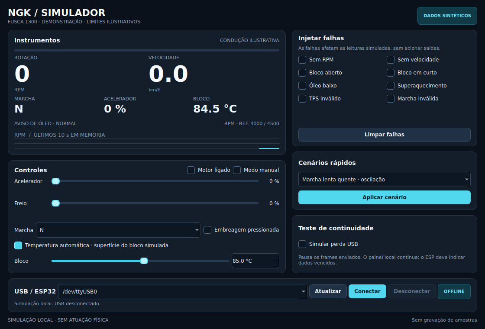
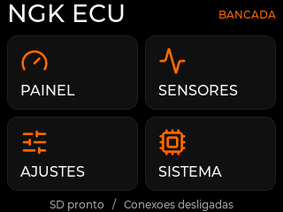
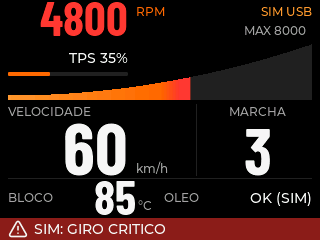

# NGK ECU

Projeto experimental de painel e futura ECU para um motor boxer Volkswagen
Fusca **1300 carburado**, de ano desconhecido, em uma gaiola de uso fora de
estrada, usando ESP32 com tela touch.
Referência funcional: instrumentos e configuração na própria tela, como em
painéis de gerenciamento de motor. Interface e firmware serão próprios.

## Primeira etapa

| Medição | Unidade | Informação ainda necessária |
| --- | --- | --- |
| Rotação do motor | RPM | Origem do sinal, níveis elétricos e pulsos por volta |
| Temperatura do bloco | °C | Sensor, ponto de instalação e calibração |
| Velocidade do veículo | km/h | Sensor, pulsos por volta e circunferência da roda |

Armazenamento em cartão microSD de 32 GB, preparado e verificado em FAT32
pela própria placa. Incluir os sensores e sinais originais que
efetivamente existem nesse motor, conforme o [inventário](docs/sensores-motor.md).
Mapas de combustível, injeção **monoponto**, ignição e outras
automações pertencem a etapas futuras, com projeto elétrico e validação próprios.

Substituição do firmware e manutenção/formatação do SD pela própria placa
foram autorizadas. Não é necessário um leitor externo para o fluxo escolhido.

## Estado atual

- Firmware próprio de bancada em [firmware/ecu](firmware/ecu/README.md), com
  menu de quatro botões, sete páginas de ajustes e instrumentos `-- / SEM SINAL`. Nenhum sensor/atuador externo
  está habilitado. A aplicação de referência não é o produto da ECU.
- Foto indica a família **ESP32-2432S028**; revisão e pinagem pendentes de confirmação.
- Consulta USB confirmou **ESP32-D0WD-V3 rev. 3.1, flash de 4 MiB** e ponte CH340.
  Backup local completo conferido antes de gravar manutenção temporária.
- Um cartão reportou **1.898 MiB**, divergindo dos 32 GB informados; a trava
  impediu formatação. O responsável retirou esse cartão e informou ter colocado
  o correto. A consulta nova confirmou **30.255 MiB**; esse cartão foi preparado
  em FAT32 e passou por escrita/leitura de arquivo próprio temporário.
- REA 6.8.0 e esptool 5.6.0 instalados localmente e com versões verificadas.
  Análise do ELF próprio executada com objdump via REA; não houve
  descompilação Xtensa.
  Instalar a ferramenta não identifica automaticamente tela ou GPIOs.

## Simulador Linux

Aplicativo nativo com acelerador, freio, embreagem, marchaR/N/1–4, temperatura,
RPM/velocidade manuais e falhas selecionáveis. Funciona offline; Conectar envia
simulação pela USB para o firmware 0.4.6-cockpit. O painel marcaSIM USB e deixa
os dados indisponíveis após 750 ms sem frames. Motor/sensores físicos continuam
desabilitados. Modelo ilustrativo, sem calibração do veículo.

Lenta com oscilação suave, partida fria e temperatura automática; avisos de giro
a 4.000/4.500 RPM com histerese. São referências de bancada, sem corte de motor.
O modo manual aceita 9.000 RPM para ensaiar alertas. Consulte as
[referências do motor e limites do modelo](docs/referencias-motor-e-simulacao.md).

```sh
./scripts/simulator
```

[Uso, instalação e testes](simulator/README.md). O aplicativo inicia desconectado,
sem gravar amostras. Atalho local: **NGK ECU Simulador**.



## Documentação

- [Todos os pedidos organizados em cinco etapas](docs/plano-geral.md)
- [Escopo e próximos marcos](docs/escopo.md)
- [Inventário de hardware e pendências](docs/hardware.md)
- [Ferramentas e REA](docs/ferramentas.md)
- [Validação e bloqueios observados](docs/validacao.md)
- [Sensores do motor 1300 carburado](docs/sensores-motor.md)
- [Referência visual e limites de desempenho](docs/interface.md)
- [SD, memória e otimizações](docs/armazenamento-e-desempenho.md)

## Liberar a serial nesta conexão Linux

A porta atual é `/dev/ttyUSB0` e o sistema dispõe de `setfacl`. Executar no
terminal do operador, com autorização administrativa:

```sh
sudo setfacl -m "u:$(id -un):rw" /dev/ttyUSB0
```

A ACL dá leitura/escrita ao usuário atual sem exigir nova sessão ou mudança
de grupo. Vale para o dispositivo desta conexão; ao reconectar, conferir o
nome da porta e repetir se necessário. Não compartilhar senha com o agente.
Se essa conta não estiver no sudoers, a liberação deve ser feita por uma conta
administradora, usando o UID da sessão original como destino. Não substituir
por `id -u` já dentro da conta administradora, pois daria acesso ao usuário errado.
O comando não concede privilégio administrativo à conta do agente.

## Limites de validação

O painel começa sem saídas de atuação. Não conectar sinal de bobina, rede de
12 V ou sensor de tensão desconhecida diretamente ao ESP32. São necessários
condicionamento de sinais e alimentação adequada ao ambiente veicular.
Montagem USB em bancada não valida operação no veículo.

A versão **0.4.6-cockpit** está instalada em bancada. Tela preta com laranja e
vermelho, menu 2×2, instrumentos grandes e barra RPM contínua em rampa curva.
O redesenho afeta somente a ESP32; o visual do simulador foi preservado.
A revisão 0.4.3 acrescenta ícones Lucide consistentes, números ancorados pela
direita com unidades fixas e faixa de alerta com símbolo e texto maior.
A 0.4.5 compactou o RPM no topo e ampliou a rampa de 24 para 56 px de altura.
A 0.4.6 amplia marcha e temperatura, aproxima velocidade/unidade, mostra a
escala RPM e aproveita o vão acima da curva com TPS e sua barra, somente em SIM.
A barra usa interpolação com cadência alvo de 60 Hz; os números, cerca de
30 Hz no modo Suave. Alarmes e perda de sinal têm prioridade imediata.

Dezesseis executáveis nativos, quinze testes de fontes, dois testes de ícones,
seis testes de captura, 55 testes do simulador e três builds passaram. A bancada mediu aproximadamente **60 apresentações
parciais/s** no caminho SIM animado. Isso não representa 60 telas completas/s
ou medição óptica; intervalos, consumo de memória e limites estão no
[relatório de validação](docs/validacao.md#acabamento-dos-instrumentos--043).
Sensores, atuação e uso no veículo continuam sem validação.

Wi-Fi e BLE estão disponíveis sob demanda e começam desligados. Nesta unidade,
a proteção de memória recusou ambos simultaneamente: usar um por vez.
O SD guarda perfis visuais; não substitui RAM nem buffers DMA.

Todos os pedidos estão organizados em [cinco etapas](docs/plano-geral.md).
A [skill ESP32](docs/ferramentas-esp32.md) foi instalada localmente e auditada;
o [ESP-MCP e as alternativas de IA](docs/avaliacao-ferramentas-ia.md) foram
avaliados sem acrescentar ML/API ao firmware sem uma função definida.

Capturas recebidas diretamente dos pixels enviados pela ESP32 ao LCD,
com dados sintéticos; não são fotografias:




Prévia adicional renderizada com LVGL no host:


[Captura direta dos pixels da ESP32](docs/captura-tela.md), acionada pelo Linux:

```sh
.venv/bin/python tools/capture_screen.py --output artifacts/esp32-screen.png
```

Feche o simulador para liberar a porta. Durante a captura, a animação pausa
para transferir os pixels; o PNG só é salvo após conferir tamanho e CRC.

Teste sem hardware: `sh scripts/test-native.sh`.
Compilação e operação: [guia do firmware](firmware/ecu/README.md).
