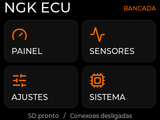
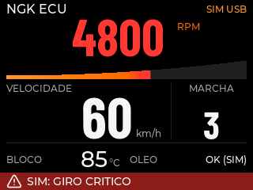
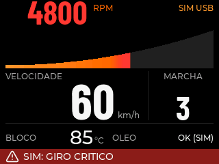
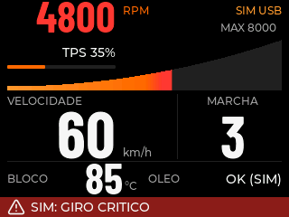
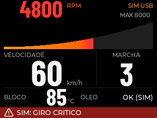
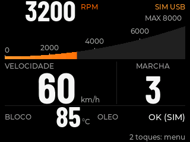
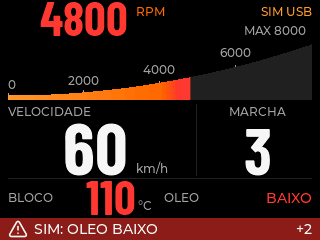

# Captura da tela desenhada pela ESP32

A versão 0.4.4 acrescenta `screen-capture`. A própria ESP32 redesenha a tela e
transmite os mesmos pixels RGB565 enviados ao LCD. O Linux recebe, confere a
integridade e salva um PNG. Isso difere das prévias anteriores, renderizadas
pelo LVGL no host. Não é fotografia nem leitura de retorno do controlador LCD.

## Usar no Linux

Feche o simulador antes, para liberar a porta; a captura é uma ação explícita
de diagnóstico. Com a placa já autorizada/acessível e a `.venv` do projeto:

```sh
.venv/bin/python tools/capture_screen.py --port /dev/ttyUSB0 \
  --output artifacts/esp32-screen.png
```

Depois, reabra `./scripts/simulator`. A captura funciona no Menu, Painel,
Sensores ou índice de Ajustes. Recusa teclado, páginas de configuração,
Sistema, confirmação, calibração e pareamento, além de ações/ensaios pendentes.
O cliente exige identificação NGK ECU, build normal, protocolo de captura 1 e
entradas/atuadores físicos desabilitados.

## Desempenho e formato

A captura congela o quadro/animação durante a transmissão. A 115200 baud, são
cerca de 14 segundos para 153600 bytes de pixels, além de desenho/protocolo.
Não é uma função de vídeo ou de registro contínuo. A transmissão pela UART tem timeout; após retornar, o loop observa novamente TTL/validade e retoma o painel.

Não há snapshot de tela inteira ou arquivo SD na ESP32. O comando reutiliza os
dois buffers DMA 320×16 já existentes, sem liberar um tile enquanto UART/DMA
estiverem lendo. O LVGL mantém um único dono. Somente o Linux guarda a imagem
completa e cria o PNG. Nenhuma amostra/serial bruto é salva pelo cliente.

Fluxo serial, somente após o comando explícito:

```text
NGK_SCREEN RGB565_BE 320 240 153600\n
<153600 bytes binários exatos, linhas de cima para baixo>
\nNGK_SCREEN_END 153600 <CRC32 hexadecimal de 8 caracteres>\n
```

Quebras de linha dentro dos pixels são dados. Geometria inválida, frame
incompleto, CRC incorreto ou erro de transporte impedem salvar a imagem.
Respostas antigas são drenadas antes do header. Os demais comandos continuam
fora do payload; não há streaming espontâneo ou credenciais no protocolo.

As capturas desta bancada usam menu/dados SIM identificados. Elas conferem os
pixels produzidos pela ESP32; cores físicas, orientação do painel, integridade
do cabo SPI, brilho, toque e luz emitida exigem observação do LCD.

## Capturas recebidas da placa

Estas imagens foram recebidas pelo comando na versão 0.4.4, com 153600 bytes
conferidos por CRC32 em cada captura. O menu levou 13,364 s; o painel 13,357 s.
O painel usa valores sintéticos, identificados como SIM USB.




## Painel com RPM compacto — 0.4.5

Nova captura recebida da placa: RPM compacto e rampa de 56 px, com valores SIM.
Payload 153600 B, CRC32 `64495377`, conferido antes de salvar PNG.



## Nova distribuição — 0.4.6

Captura recebida da ESP32, dados SIM, CRC32 `1e4507fe` conferido.
Marcha e temperatura maiores; TPS/escala ocupam os espaços superiores.



## Painel sem TPS — 0.4.7

Texto e barra TPS removidos a pedido do responsável. Captura recebida da ESP32
com dados SIM, 153600 B e CRC32 `eada1b33` conferido; 13.36 s.



## Graduação e contador de falhas — 0.4.8

Duas capturas recebidas da própria ESP32, fonte sintética claramente identificada;
153600 B cada e CRC32 conferido. Normal `bc04c979`; falhas simultâneas
`b4c8e2d4`. TPS ausente, instrumentos e curva preservados.



