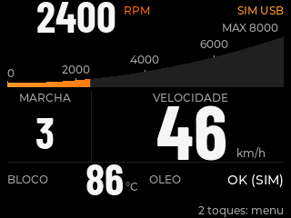

# Ambiente de desenvolvimento ESP32 touch

Verificado em 2026-11-12 no projeto **NGK ECU**, base `2e27aa4`.
A pasta InterfaceNeural é outro projeto Python e foi preservada. Este setup
não abriu serial, gravou firmware, reiniciou a placa ou alterou partições.
O pedido posterior autorizou aplicar os recursos à melhoria do código:
a recepção serial foi corrigida na candidata 0.4.12-rx, com teste em memória e build;
ver [alteração e limites](serial-rx-0412.md).

## Ambiente e versões preservadas

| Item | Versão / evidência |
| --- | --- |
| Sistema | Ubuntu 26.04.1 LTS, Linux x86_64 |
| Agente | Codex CLI 0.167.2, acessível nesta sessão via ambiente Orca |
| Python / PlatformIO | Python 3.12.3 na `.venv`; PlatformIO 6.1.18 |
| Framework | `espressif32@6.9.0`, Arduino-ESP32 2.0.17, SDK pré-compilado ESP-IDF 4.4.7 |
| Toolchain | Xtensa GCC 8.4.0+2021r2-patch5, C++17, alvo `esp32dev`, CPU 240 MHz |
| Interface / rádio | LVGL 8.4.0; LovyanGFX 1.2.7; NimBLE-Arduino 2.5.1 |
| Ferramentas auxiliares | esptool 5.6.0; REA 6.8.0 / Node local 24.22.1; PySide6-Essentials 6.12.0 |

Fontes de versão: `firmware/ecu/platformio.ini`, manifests em `.pio/libdeps`,
pacotes em `.tools/platformio/packages`, `esp_arduino_version.h`,
`esp_idf_version.h` e metadata da `.venv`. As dependências já estavam disponíveis;
nenhuma atualização de framework, SDK, biblioteca ou pacote global foi necessária.

## Hardware: perfil ativo e limites

O histórico registra serigrafia ESP32-2432S028, chip ESP32-D0WD-V3 revisão 3.1,
flash de 4 MiB, sem PSRAM e tela horizontal de 320×240. O perfil ST7789 apresentou imagem
legível; o touch resistivo usa driver XPT2046. A revisão/sufixo da PCB, o CI exato
do LCD, o vidro TN/IPS e a função de cada conector USB continuam não confirmados.
USB/CH340 não identifica a pinagem. Não há GPIO atribuído a sensores/atuadores.

O código em [board_profile.hpp](../firmware/ecu/include/board_profile.hpp) e
[board.hpp](../firmware/ecu/include/board.hpp) é a fonte do perfil operacional:

| Função | Perfil preservado |
| --- | --- |
| LCD SPI2 | SCLK 14, MOSI 13, MISO desabilitado, CS 15, DC 2; SPI 40 MHz |
| Luz | GPIO 21; PWM 12 kHz |
| Touch SPI em software | SCLK 25, MOSI 32, MISO 39, CS 33, IRQ 36 |
| SD VSPI separado | SCLK 18, MOSI 23, MISO 19, CS 5 |
| Memória gráfica | RGB565; dois buffers de 320×16, 20 KiB total; pool LVGL de 32 KiB |

Essa tabela descreve o firmware verificado em bancada no histórico, não um
esquema elétrico universal de todas as placas 2432S028. Os ensaios posteriores de
[validação](validacao.md) superam a pendência histórica de simultaneidade UI/SD;
nesta etapa não houve novo teste físico de display, touch, SD ou veículo.

## Comandos essenciais

Execute na raiz deste repositório:

```sh
.venv/bin/python scripts/setup-esp32-agent.py --check
PLATFORMIO_CORE_DIR="$PWD/.tools/platformio" .venv/bin/pio run -d firmware/ecu -e ecu-normal
sh scripts/preview-ui
sh scripts/test-native.sh
sh scripts/test-simulator.sh
```

A compilação inicial, antes de alterar configurações, passou em 3,84 s:
RAM estática de 96.848 B, flash de 1.417.833 B. Log privado: `local/esp32-setup/build-before.txt`.
Build é diferente de upload: não adicionar `-t upload`, erase, monitor ou reset
a estes comandos sem uma etapa física explicitamente autorizada.

## MCPs usados pelo agente

Os serviços foram configurados em `.codex/config.toml`, com URL/timeout,
sem tokens. O [Codex](https://learn.chatgpt.com/docs/extend/mcp?surface=cli) só carrega
configuração de projeto confiável: foi
acrescentada **apenas a confiança desta raiz** em `~/.codex/config.toml`.
Servidores, hooks, modelos e demais preferências anteriores foram preservados.
Backups privados ficam em `local/esp32-setup/backups/`, ignorados pelo Git.

| Serviço | Estado observado e chamada real |
| --- | --- |
| [Espressif Documentation](https://mcp.espressif.com/) | **Verificado**: OAuth separado; `search_espressif_sources` consultou RX UART/buffers/bloqueio de TX. |
| [Espressif Engineering](https://ts-mcp.espressif.com/en/connect) | **Verificado**: OAuth separado; `ts_skill_list` descobriu o catálogo e `ts_skill_get` leu `setup/espressif-env-setup`. |
| [LVGL Documentation](https://lvgl.io/docs/pro/ai) | **Verificado**: OAuth próprio; `search_lvgl_light_and_versatile_graphics_library_knowledge_sources` consultou threads e validade dos buffers DMA. |

As chamadas foram feitas por um cliente Codex 0.167.2 novo e efêmero, usando
esta configuração de projeto. O catálogo da sessão antiga não se atualiza só
por editar TOML; abra nova conversa Codex/Orca com **ngk-ecu como raiz** para
usar os novos nomes diretamente. O cliente de validação já realizou as leituras;
não estamos classificando simples cadastro como consulta bem-sucedida.

A política sem prompts do CLI inicialmente bloqueou a leitura Engineering.
Foram permitidas especificamente as ferramentas **somente leitura**
`ts_skill_list` e `ts_skill_get` no projeto; não foi liberada aprovação automática
para todos os comandos ou ferramentas. A leitura final passou.

Os MCPs de Documentation e LVGL retornaram fontes atuais, não comprovaram por
si só compatibilidade com as versões antigas. As decisões foram confrontadas
com os headers locais e com
[UART IDF 4.4.7](https://docs.espressif.com/projects/esp-idf/en/v4.4.7/esp32/api-reference/peripherals/uart.html),
[threads LVGL 8.4](https://lvgl.io/docs/open/8.4/porting/os) e
[display LVGL 8.4](https://lvgl.io/docs/open/8.4/porting/display).
O workflow Engineering lido é exclusivo para instalação nova de ESP-IDF/AT/ADF;
por isso não foi aplicado como migração deste Arduino existente. Seu pacote
tem SHA-256 `f098b5bbdcc5d886eb721f7df163e36111970f1f3788d6c2ab0cbdfa641cf4c9`.

As credenciais OAuth são gerenciadas pelo Codex fora dos arquivos versionados.
Para renovar um login, se necessário, execute separadamente:

```sh
codex mcp login espressif-docs
codex mcp login espressif-engineering
codex mcp login lvgl-docs
```

Confira o domínio, cliente e permissões no navegador; não envie senhas/tokens
ao chat. Na validação desta máquina, os três logins concluíram.

## Recursos não aplicáveis e skill existente

- **ESP-IDF Tools MCP local oficial / Registry:** não aplicáveis a este projeto
  Arduino/PlatformIO com SDK 4.4.7 pré-compilado. Não há ESP-IDF completo/`IDF_PATH`.
  O [MCP local oficial](https://developer.espressif.com/blog/2026/04/esp-idf-tools-mcp-server/)
  não justifica migrar o firmware. O `horw/esp-mcp` local antigo tem sete schemas
  já auditados, usa `idf.py` e não é um adaptador do PlatformIO nem prova suporte a monitor.
- **EEZ/SquareLine:** não há projeto de editor visual; não foi introduzido outro gerador.
- **Skill:** mantida `.agents/skills/esp32/SKILL.md`, ezrover no commit
  `124d298e4ccaa737dbf6d26bbae47722e17f3097`, com autoria/licença/auditoria intactas.
  Já cobre memória, DMA/IRAM, ISR, watchdogs e comunicação. A skill genérica
  Jeffallan foi avaliada e não duplicada; seus exemplos STM32/FreeRTOS não são
  templates ESP-IDF. No ESP32, conferir stacks em **bytes**, portMUX/SMP,
  APIs `FromISR` e o scheduler já iniciado contra o SDK 4.4.7.

Use os procedimentos de Engineering quando corresponderem à tarefa; não execute
comandos de instalação/flash só porque constam em uma skill recuperada.

## Prévia e limites

`sh scripts/preview-ui` compila o LVGL 8.4 real, a tela e as fontes do firmware
em um ambiente host separado. Onze cenas e três testes do driver passaram;
as capturas foram executadas e inspecionadas, incluindo extremos e alertas.
Ver [instruções, proveniência e comparação dos simuladores](preview-interface.md).



É uma renderização estática, sem janela interativa nem comprovação de touch,
SPI/DMA físico, FPS óptico, sensores ou veículo. Os simuladores upstream atuais
usam LVGL diferente; o harness já existente foi reaproveitado sem migrar a UI.

## Reexecutar e desfazer somente este setup

O script `setup-esp32-agent.py --apply` mescla apenas entradas ausentes, reutiliza
URLs equivalentes mesmo com outro nome e cria backup antes de modificar arquivo.
`--check` não modifica configurações. Nenhuma opção executa OAuth, instalação,
compilação, upload ou comandos físicos automaticamente.

`--undo` remove somente os blocos reconhecidos deste setup, preservando outras
entradas; se o bloco tiver sido editado, recusa remover silenciosamente. Não
restaure o backup global inteiro sobre novas preferências adicionadas depois.
Os logins OAuth são independentes: para removê-los também, use `codex mcp logout`
para cada um dos três nomes **antes** de remover a configuração. Não remova
credenciais compartilhadas com outros projetos sem verificar seu uso.

O código e os arquivos de prévia ficam no Git; podem ser revertidos separadamente.
Apagar `local/ui-preview/` remove apenas o cache e as imagens geradas no host.

## Resultado final desta execução

Cinco variantes compilaram após a correção, incluindo normal, referência,
diagnóstico de carga, diagnóstico SD e manutenção. Normal: RAM estática de 96.848 B
(igual à base), flash de 1.417.901 B (+68 B). Passaram 22 executáveis nativos ASan/UBSan,
102 testes Qt/cliente em memória,13 testes do setup em pastas temporárias e3 testes
do renderer. Onze cenas foram geradas novamente e as capturas mantiveram os
mesmos pixels. Auditoria dos 14 sinais: zero erros e três avisos conhecidos.

REA 6.8.0 inspecionou o ELF candidato: exit 0, complete, sem alterar artefato.
O teste em RAM de 100 Hz passou; o timeout físico anterior ainda exige reteste
na placa. Não houve gravação nesta etapa.

[Resumo sanitizado e evidências](measurements/esp32-agent-setup-2026-11-12.json).
