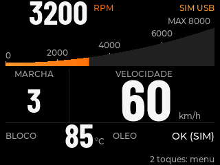
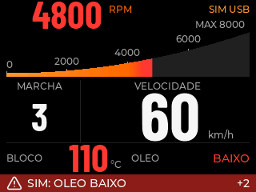

# Fluidez: distribuir números entre quadros — 0.4.10

**Versão normal instalada e medida na ESP32 em 2026-11-11.** A mudança distribui
RPM e velocidade em quadros alternados no modo Suave. Durante movimento não urgente, cada número recebe cerca de
30 oportunidades por segundo; a rampa mantém alvo de 60 Hz.
Urgências, perda de validade/TTL e primeira pintura atualizam ambos imediatamente.
Equilibrado, Econômico e Reduzir movimento conservam a política anterior.
DEMO tem agenda independente. Disposição, fontes, cores e duplo toque permanecem.

[Agregados revisáveis](measurements/frame-scheduling-2026-11-11.json).

## Resultado do A/B no mesmo binário

Duas execuções por modo, fonte USB sintética de 20 Hz, janelas de aproximadamente 10 s,
mesmo perfil, rádios desligados e seletor temporário em RAM. O seletor/comandos
foram removidos da versão normal. A referência pública `ecu-render-reference`
permite compilar a política combinada com `NGK_COMBINED_NUMBERS`.

| Métrica, média dos dois casos em movimento | Combinado | Alternado | Variação |
| --- | ---: | ---: | ---: |
| p95 entre apresentações parciais | 32,882 ms | 24,008 ms | −27,0% |
| Maior intervalo entre apresentações | 34,837 ms | 25,074 ms | −28,0% |
| Maior tempo de um tick da UI | 18,410 ms | 14,447 ms | −21,5% |
| Maior quantidade de pixels por apresentação | 15.808 | 11.779 | −25,5% |
| Tempo acumulado do tick na janela | 4,494 s | 4,693 s | **+4,4%** |

A prioridade escolhida foi regularidade: a carga foi distribuída entre quadros.
O tempo acumulado aumentou neste A/B; **não houve demonstração de mais CPU livre**.
Esse tempo inclui desenho, espera DMA e preempção. Pixels totais caíram somente
cerca de 1,35%; o ganho principal está nos picos e intervalos.

O primeiro alternado precisou de cinco tentativas antes de iniciar; sua fase da
onda ficou deslocada. O segundo teve uma tentativa e repetiu o ganho. Não são
arrancadas com fase idêntica, nem um estudo estatístico de todas as cargas.
O p95 de apresentação usa os últimos 256 intervalos, não os 599/600 inteiros;
máximos e contagens abrangem toda a janela. O p95 amostra→primeira mudança usa
as últimas 128 observações e pode ser satisfeito pela rampa, sem esperar os dois números.
Não são FPS óptico, 60 telas completas/s ou validação no veículo.

## Confirmação no firmware normal

Três casos sem carga: 600/601/600 apresentações, p95 de 24,237–24,432 ms,
tick máximo de 14,487–14,508 ms. RPM teve 300 despachos em cada caso; velocidade
255–258 porque deixa de ser processada quando não há mudança pendente.
Gaps de despacho incluem períodos sem trabalho; não medem idade da amostra.
Tentativas antes de iniciar: 1/3/3; a fase da onda também varia entre esses casos.

No repouso: 9800 saídas antecipadas, zero passagens de instrumentos/números,
zero pixels transferidos. Fonte/TTL e consulta de toque continuaram ativos.

Remontagem pontual do SD: revisão de perfil 1→2/status 12/montado confirmou execução;
600 apresentações, p95 de 24,748 ms, tick máximo de 17,210 ms. Houve uma repintura de
detalhes. **Não é um ensaio de escrita contínua ou logging.** Produção continua
salvando somente pequenos perfis pelo worker já existente.

### Por que a métrica da rampa chegou a 34 ms

A métrica antiga conta conclusões observadas por polling de tiles DMA que
cruzam a base da rampa. Ela também pode contar regiões unidas a outros objetos.
`updateRpmBar` não solicita invalidação se posição Q8 e cores não mudam.
Um quadro só numérico pode existir entre dois novos desenhos da barra.

A observação adicional separou chamadas sem invalidação e gaps de tiles com/sem
esse evento desde a conclusão anterior. Nos casos 2/3, houve 3 chamadas estáveis;
os gaps de 34,086/34,111 ms apareceram **somente nessa classe**. Sem chamada estável,
o maior gap foi 22,176 ms. As chamadas da rampa tiveram intervalo máximo de 18,126 ms:
não houve uma pausa de 34 ms entre essas chamadas. As contagens também fecharam:
601−3=598 e 600−3=597 transferências observadas da base da rampa.

Isso demonstra associação temporal e a distinção entre despacho e novo desenho;
não determina latência óptica nem garante causalidade única. Na borda da janela,
um passe pode ficar sem conclusão correspondente. O contador original foi mantido
para preservar a leitura dos relatórios antigos.

## Software, memória e imagens

19 executáveis nativos com ASan/UBSan e 87 testes do simulador passaram. O novo teste
cobre 30/30 Hz, pendências terminais independentes, urgência/TTL/sessão, mudanças de
modo, rollover e ausência de rajadas; a política anterior reproduziu o RED.
Os quatro builds — normal, referência, manutenção e diagnóstico SD — passaram.
Auditoria de 14 sinais: zero erros e os três avisos de strapping conhecidos.

Normal: 96.832 B de RAM estática e 1.417.781 B de flash; contra 0.4.9, RAM +120 B.
Buffers DMA de 20 KiB e pool LVGL de 32 KiB foram preservados. Não há novo framebuffer,
cache de bitmap ou uso do cartão como RAM. O linker não mede pico de heap ou CPU.

As duas capturas recebidas do LCD transportaram 153.600 B cada e passaram no CRC.
Normal `d508fbca`; alertas `7fb2f473`. Os PNGs são byte a byte iguais às imagens
0.4.9 já publicadas, reaproveitadas abaixo. Isso confirma a preservação dos pixels
nesses dois estados; a captura congela a UI e não mede fluidez.

Uma captura adicional de alerta como primeiro estado repetiu o CRC `7fb2f473`.
A comparação independente da região central confirmou sua igualdade nos dois estados.

## Preservação e decisão

Antes dos ensaios, o aplicativo original 0.4.9 foi preservado em backup privado.
As escritas atingiram somente o aplicativo 0x10000 e tiveram hash verificado.
A versão normal final tem 1.424.352 B, SHA-256
`8fcdd7181d936f7073de1f034c01cdf8857d0ad252cddc91baf93fa87d5a5592`.
Cartão, NVS, calibração, partições e GPIOs foram preservados. Todos os casos
encerraram SIM e restauraram rádios; entradas de sensores e atuadores seguem desativadas.

Três tentativas anteriores de redesenho parcial dos glifos foram descartadas:
a última reduziu pixels 12,26%, mas só poupou 0,40% no tempo acumulado e piorou a
rampa p95 de 22 → 23 ms. Seu cálculo custava quase toda a economia. Esse helper e seus
probes não integram a entrega. A revisão independente aprovou código, observação,
medidas e preservação das imagens da abordagem de agendamento.
