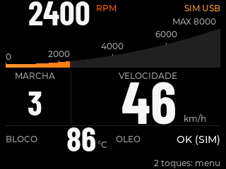
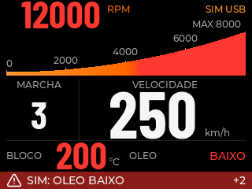
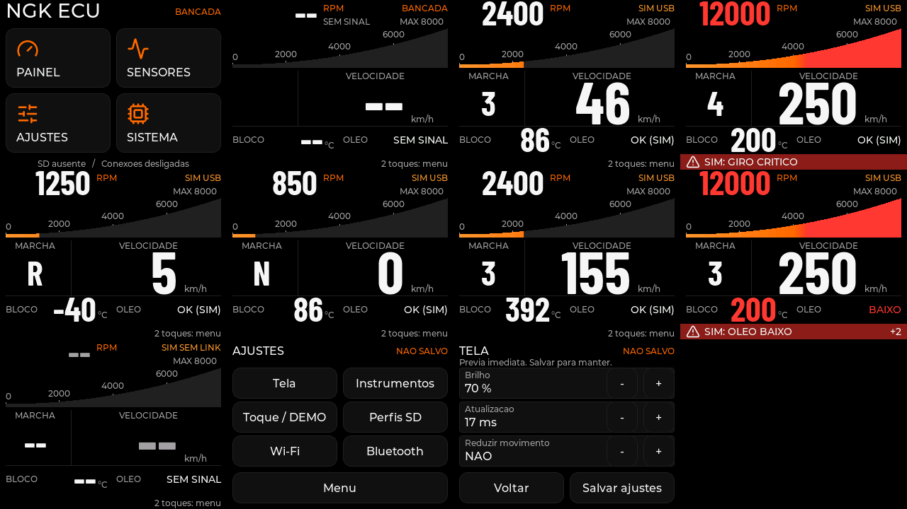

# Prévia local da interface ESP32

Execute na raiz:

```sh
sh scripts/preview-ui
```

A prévia compila a tela real com **LVGL 8.4.0**, usa dados sintéticos em memória
e produz `local/ui-preview/images/contato.png`. Não abre USB/serial, não grava
firmware, não reinicia a placa e não instala dependências.

## Requisitos e reprodução

1. Use a `.venv` Python 3.12 já preparada no projeto.
2. Tenha os compiladores host `gcc` e `g++` disponíveis.
3. Preserve o LVGL 8.4.0 já resolvido em `firmware/ecu/.pio/libdeps/ecu-normal/lvgl`.
4. Execute `sh scripts/preview-ui`.
5. Abra `local/ui-preview/images/contato.png`.

O script não chama PlatformIO nem busca pacotes na rede. Uma cópia local da
mesma versão pode ser indicada com `--lvgl-dir CAMINHO`. A versão é conferida
em `library.json` e `lvgl.h`; outra versão é rejeitada antes da compilação.
`--jobs 1` limita a compilação; `--output local/minha-previa` escolhe outra pasta
para imagens, `manifest.json` e `validation.txt`. Use uma pasta própria para
artefatos: os nomes de saída documentados são substituídos a cada execução.

O cache de objetos/executável fica em `local/ui-preview/build/`, separado do
firmware. A chave SHA-256 inclui código e headers do firmware, fontes, ícones,
fontes C/headers do LVGL, harness, stubs, driver e versões dos compiladores.
Mudanças nesses insumos exigem nova compilação. Não há pacote Python adicional,
SDL, janela gráfica, daemon MCP nem modificação da configuração global.

## O que é executado

O ponto de partida foi o renderer já existente em
`local/ui-redesign/render.py`, com seus stubs e harness, que estava fora dos
arquivos versionados e dependia de listas antigas de assets. O fluxo estável
passou para [tools/ui_preview](../tools/ui_preview/) e
[scripts/preview-ui](../scripts/preview-ui).

O driver copia `firmware/ecu/src/ui.cpp` e seus headers para uma pasta privada,
sem substituir posições, estilos, widgets ou funções de desenho. Acrescenta
somente hooks de navegação e inspeção à cópia host. Compila o serviço real
`simulation_service.cpp`, as fontes `ngk_*.c`, os ícones reais e o renderer
software do LVGL. O layout não foi traduzido para outro framework.

A resolução vem do perfil real **320 × 240**, com RGB565 e troca de bytes,
tiles de 16 linhas e pool LVGL de 32 KiB. As fontes atuais incluem
NGK Cockpit48/84 e NGK Gear48, conforme o código desta base; não se reaplica o
layout antigo 72/64 de ensaios anteriores. O PNG converte o resultado RGB565
para RGB888 sem alterar sua composição. Licenças dos assets permanecem em
[third_party/licenses](../third_party/licenses/README.md) e
[third_party/icons/lucide](../third_party/icons/lucide/README.md).

Somente no host, `board.hpp` recebe pixels em um framebuffer; relógio, DMA,
touch, heap ESP, NVS, SD e rádios são stubs. O símbolo `Serial` é um destino em
memória sem acesso a dispositivos e a captura UART da produção não é chamada.
Como não há NVS, a tela abre o fluxo de calibração; o hook host descarta esse
overlay para navegar nas páginas. Nenhuma calibração real é escrita ou
considerada validada. Os números de heap dos stubs não são medições do ESP32.

## Capturas e inspeção

As imagens abaixo são **renderizações host de dados sintéticos**, não capturas
da placa. A palavra `SIM USB` é desenhada pelo próprio código da interface para
essa fonte; neste ensaio os frames são submetidos diretamente em memória, sem
USB.







Ordem de leitura do contato, da esquerda para a direita por linha:

| Linha | 1 | 2 | 3 | 4 |
| --- | --- | --- | --- | --- |
| 1 | Menu | Painel sem sinal | SIM 2400 RPM/46 km/h | Máximos 12000 RPM/250 km/h/200°C |
| 2 | Ré/-40°C | Neutro/0 km/h | Imperial 155 mph/392°F | Óleo baixo + duas causas adicionais |
| 3 | Fonte sem link | Categorias de ajustes | Ajustes de tela | Espaço vazio |

A inspeção visual conferiu números, unidades, escala, estados N/R, alinhamento
da marcha à esquerda e velocidade à direita, indicação SIM, alerta com ícone e
contador `+2`, além da remoção de valores/alertas após perder o link. Não foi
observado clipping nos instrumentos dessas cenas. Os asserts usam as métricas
reais dos glifos e os limites dos pais LVGL/tela; também verificam que unidade e
velocidade não se sobrepõem. Não constituem auditoria automática de todos os
widgets/páginas ou avaliação de legibilidade no veículo.

## Verificações realizadas — 2026-11-12

```sh
.venv/bin/python -m unittest discover -s tools/ui_preview -p 'test_*.py'
sh -n scripts/preview-ui
sh scripts/preview-ui
sh scripts/preview-ui
```

Três testes do driver passaram: PNG com decodificação/checksum independente,
rejeição de pixels truncados e rejeição de LVGL divergente/inconsistente. O
harness passou nas 11 cenas, incluindo leituras esperadas, limites geométricos,
conversões e invalidação por TTL. As duas execuções produziram os mesmos
SHA-256 dos 11 PNGs individuais e do contato; a segunda reutilizou o cache.

Sistema usado: Linux x86_64, Python 3.12.3 da `.venv`, GCC/G++ 15.2.0. Os
headers de desenvolvimento SDL2 não foram encontrados por `pkg-config`.
Nenhum pacote do sistema foi instalado. Compilação host usa C99/C++17 e `-O1`.

Proveniência da captura registrada:

| Insumo | SHA-256 / base |
| --- | --- |
| Commit de base | `2e27aa4940468e3e87daa74e8cc6536070bbf70c` |
| Chave completa de fontes/ferramentas | `ab3144f800b3635aee68abda09106fb3b6f02181ea1f80c3b51001869693ef2b` |
| Mapa dos hashes LVGL, JSON ordenado | `a02ae45eb4a356d3de52c0e70361e300ca95cbe795d0a3e0b1c1e6d55b079c97` |
| `src/ui.cpp` | `7ea9b70d7af518dfe96d6c25cbd9739e8a458a0e41e4268b2b29fa8deb1e41f3` |
| `include/ui_layout.hpp` | `f3011dcb73e1ad8fda03327c553bcd5ae6ee7d6cf298d0278224e31bf946ffb2` |
| `include/lv_conf.h` | `97638b641b117d008fd4a98e76f8496b5cbf3ff6a4c2f9c77fed26a57dcc6830` |

O manifesto local contém o mapa completo de SHA-256 por arquivo e as versões
dos compiladores. Ele é regenerado junto das capturas, permitindo identificar
mudanças futuras. Registra o comando com as opções recebidas e o número de
compilações paralelas efetivo. Nesta documentação foram usados os padrões.

## Alternativas consultadas

As fontes upstream foram lidas em 2026-11-12; nenhuma foi instalada, executada
ou usada para migrar o firmware.

| Opção | Versão e requisitos observados | Decisão |
| --- | --- | --- |
| [lv_port_pc_vscode master, `c1ea53e`](https://github.com/lvgl/lv_port_pc_vscode/tree/c1ea53e16bdb1de987389c1a500ebac77b6e1eeb) | Submódulo LVGL `9373f7c`, versão 10.0.0-dev. CMake ≥3.12.4, C99/C++17, SDL2 obrigatório; suporte opcional FreeRTOS. | Não é substituto direto de LVGL8.4. Seu HAL de PC é uma referência para uma futura janela interativa. |
| [lv_port_pc_vscode release/v8, `2ac86e6`](https://github.com/lvgl/lv_port_pc_vscode/tree/2ac86e625e21195f5001a45fe56f6eb1c3e90904) | Submódulo LVGL `2791d57`, versão 8.3.10; `lv_conf.h` antigo rotulado8.0.0/RGB32. Makefile usa X11 ou SDL2. | Está na família8, mas ainda exigiria fixar8.4.0, preservar configuração/cores/fontes locais e adaptar os serviços. Reaproveitar o harness existente reduz esse trabalho. |
| [Lvgl-mcp-esp32, `e368695`](https://github.com/jaklys/Lvgl-mcp-esp32/tree/e3686956565fe333d7b9fccd501c29e02d704b21) | Submódulo LVGL `80ca777`, versão9.6.0. Node ≥20 para MCP; C/C++, CMake ≥3.16 e Ninja/Make para renderizar código C. Oferece headless, imagens e diagnóstico. | O motor9.6 não reproduz diretamente a API/renderização8.4 desta UI. Não registrar esse MCP ou converter a UI só para obter prévia. |

Versões confirmadas nos headers dos próprios submódulos:
[LVGL10-dev](https://github.com/lvgl/lvgl/blob/9373f7cd196b365c23b5370240d3db02251e1203/include/lvgl/lv_version.h),
[LVGL8.3.10](https://github.com/lvgl/lvgl/blob/2791d5739fc00cb3802419c0fed73140910b5da7/lvgl.h) e
[LVGL9.6.0](https://github.com/lvgl/lvgl/blob/80ca777e37a2b176770726a02e07a6fb79ef0b39/include/lvgl/lv_version.h).
Requisitos conferidos nos próprios [CMake do port atual](https://github.com/lvgl/lv_port_pc_vscode/blob/c1ea53e16bdb1de987389c1a500ebac77b6e1eeb/CMakeLists.txt),
[Makefile do port8](https://github.com/lvgl/lv_port_pc_vscode/blob/2ac86e625e21195f5001a45fe56f6eb1c3e90904/Makefile) e
[README do MCP](https://github.com/jaklys/Lvgl-mcp-esp32/blob/e3686956565fe333d7b9fccd501c29e02d704b21/README.md).

## Limites da evidência

| Camada | Resultado |
| --- | --- |
| Sistema/ferramentas | Compiladores host e `.venv` usados; LVGL8.4.0 conferido; sem instalação global. |
| Execução local | Compilação, cenários sintéticos, conversões/TTL e testes do driver passaram. |
| Inspeção visual | PNGs gerados pelo LVGL real inspecionados; composição preservada nas cenas descritas. |
| Bancada/hardware | Não executados nesta configuração: touch físico, SPI/DMA real, Arduino/FreeRTOS, heap ESP32, NVS/SD e rádios não são validados pelo host. |
| Veículo | Sem avaliação de visibilidade, vibração, latência óptica, sensores ou segurança automotiva. |

A entrega é uma captura estática repetível. Interação ao vivo exigiria outro
backend de janela/entrada e integração de relógio/eventos; fica fora desta
preparação. O framebuffer de tela inteira existe somente no host, sem inclusão
no firmware de produção. Não há afirmação de FPS, latência ou consumo real.
