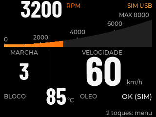
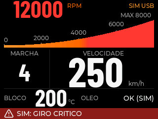
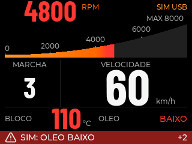

# Prévia: disposição e tamanhos do painel

Prévia publicada a pedido do responsável após esclarecer que a insatisfação
está na disposição e nos tamanhos. Base: 0.4.8, commit
`2099014b97c548d40811b48ac56597c90a452184`. Código nesta branch:
`preview/painel-disposicao`, versão `0.4.9-layout-preview`.

A publicação inicial de 2026-11-10 salvou código e imagens para revisão, sem
gravar a placa. Em **2026-11-11**, após autorização dos ensaios sem sensores e
liberação da USB pelo operador, a prévia foi instalada na ESP32 para medir
fluidez e capturar os pixels reais. Gravação somente do aplicativo em 0x10000,
com hash verificado; NVS, calibração, partições e formato do SD preservados.

## Distribuição proposta

| Instrumento | Tratamento |
| --- | --- |
| RPM | Número compacto no topo; fonte residente anterior preservada |
| Rampa RPM | 304×56 px, deslocada 4 px para cima, para y40 |
| Velocidade | À direita, região x108/y100/204×78; fonte nominal 84, linha 61 px |
| Marcha | À esquerda, região x8/y100/84×78; Gear48, linha 34 px |
| Bloco, óleo e alertas | Posições anteriores na base preservadas |

A velocidade tinha linha de 53 px; nesta proposta, 61 px. A marcha passa de
48 para 34 px, reduzindo a disputa visual. Divisória, título e unidade foram
reposicionados com os instrumentos. Paleta, fontes de dados, movimento,
repouso, prioridades de alertas, contador +N e gesto de dois toques preservados.
TPS continua fora do painel.

## Imagens da prévia

Estas imagens foram produzidas pelo **LVGL 8.4 no computador**, com dados
sintéticos e as fontes reais. Não são fotografias ou capturas da ESP32.

As temperaturas e rotações extremas são fixtures de teste, sem significado
de limite mecânico seguro ou temperatura normal do bloco.

## Validação

O ensaio em host verificou seis estados: normal, extremos, ré, neutro,
alertas simultâneos e perda de link. Os glifos e contêineres numéricos ficaram
dentro das áreas reservadas. A validação desta publicação inclui testes
nativos, reprodução/leitura das fontes e builds PlatformIO, registrados abaixo.
Na publicação inicial não houve nova medição de fluidez/CPU ou validação física.
Os ensaios posteriores estão em [validação sem sensores](validacao-sem-sensores.md).

A fonte adicional é o subconjunto numérico NGK Cockpit84, derivado da mesma
Barlow Condensed Bold fixada e sob a mesma licença OFL. Reprodução e licença em
[third_party/licenses](../third_party/licenses/README.md). Nenhum TTF, binário
de firmware, NVS ou dump do dispositivo foi adicionado à publicação.

### Resultado da publicação

Em 2026-11-10: 16 executáveis nativos com ASan/UBSan e 15 testes de fontes
passaram, sem skips na suíte de fontes. O gerador reproduziu as fontes
48/64/72/84 e Gear48/64; as fontes numéricas anteriores ficaram idênticas
byte a byte. Os três builds PlatformIO passaram: normal, manutenção e
benchmark. Auditoria: 14 sinais, zero erros e três avisos de strapping já
conhecidos. A revisão independente conferiu layout, configuração e as imagens.

Build normal: 96712 B de RAM estática (igual à 0.4.8), 1416621 B de flash
(+592 B). Esses números são do linker, sem inferir ganho de FPS ou uso real
de CPU. A composição foi posteriormente capturada no dispositivo; a preferência
do responsável pela nova disposição continua sujeita à avaliação dele.
