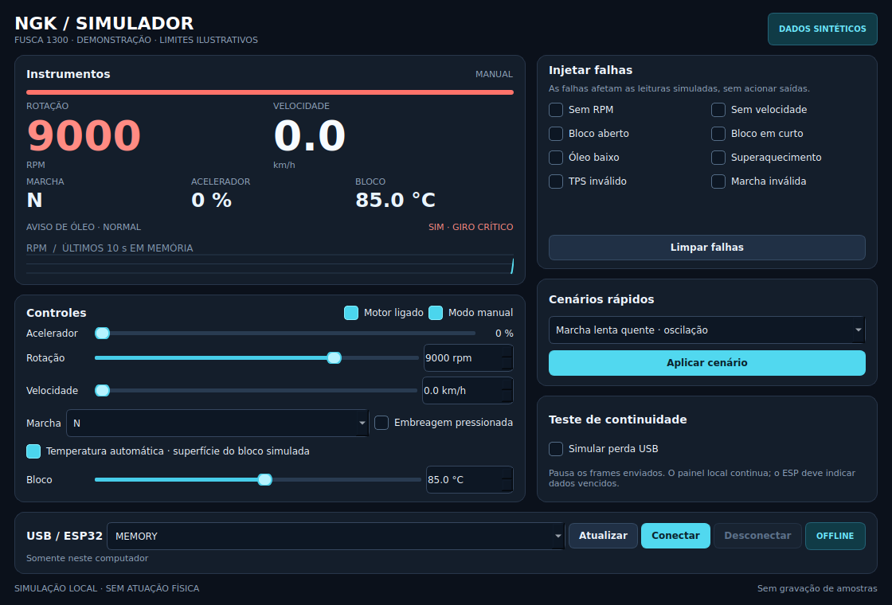

# Simulador NGK ECU no Linux

Aplicativo Qt para testar o painel com dados sintéticos. Funciona sozinho no
computador e pode enviar a simulação ao ESP32 por USB. O modelo de condução é
ilustrativo, sem calibração de motor/câmbio/pneus do veículo. Não comanda
acelerador físico, injeção, ignição ou qualquer GPIO.

## Abrir

Na raiz do projeto já preparado:

```sh
./scripts/simulator
```

O aplicativo começa **offline**. Use Conectar somente quando quiser transmitir.
O atalho do menu de aplicativos do usuário pode ser criado com:

```sh
.venv/bin/python scripts/install-simulator-shortcut.py
```

A instalação permanece nesta pasta/`.venv`; não altera Python, Qt ou permissões
do sistema. Para preparar as dependências em outro checkout, use a `.venv`
Python3.12 conforme [ferramentas](../docs/ferramentas.md) e instale:

```sh
.venv/bin/python .tools/pip.pyz install -r tools/requirements-simulator.lock
```

A versão Qt/PySide está fixada. Os
[wheels oficiais incluem as bibliotecas Qt](https://doc.qt.io/qtforpython-6/gettingstarted.html).
A pasta do projeto deve permanecer no lugar para o atalho continuar válido.

## Condução e valores manuais

1. Marque **Motor ligado**.
2. Escolha R, N ou uma marcha de 1 a 4.
3. Mova **Acelerador**; use Freio e Embreagem para variar o movimento.

Em **Modo manual**, ajuste RPM e velocidade independentemente da dinâmica.
Acelerador/TPS, marcha e temperatura continuam editáveis. RPM zero é um valor
válido; para ausência de leitura, use a falha **Sem RPM**.

O automático usa um perfil ilustrativo: lenta quente perto de 700 RPM com
pequenas oscilações, lenta fria mais alta e inércia na resposta ao acelerador.
Seu teto de 5.000 RPM é uma escolha do modelo, não limite mecânico homologado.
Para testar **9.000 RPM**, marque Modo manual e ajuste Rotação. A barra do Linux
termina em 6.000 RPM, mas o número e a transmissão mantêm até 12.000 RPM.

**Temperatura automática** aquece/resfria gradualmente conforme carga e
velocidade. Desmarque para editar a temperatura diretamente; o modo manual
sempre aceita o valor exato. O campo desabilitado é a temperatura inicial,
enquanto o instrumento mostra a temperatura simulada atual. A superfície do
bloco real ainda exige escolha do ponto e calibração. **200 °C é um extremo de
teste manual, não uma referência normal.**

Cenários rápidos incluem lenta quente, partida fria, cruzeiro, giro alto,
superaquecimento explícito e falha RPM.
Aplicar cenário substitui os controles/falhas pelo cenário escolhido.
O histórico RPM retém até10 s somente em memória e é ocultado em janelas menores.
Nenhuma amostra ou conteúdo serial é gravado em arquivo/log.

## Falhas

- SemRPM/velocidade: o instrumento correspondente mostra `--`.
- Bloco aberto/curto: falhas exclusivas, temperatura indisponível.
- Óleo baixo/superaquecimento: alerta visual com texto no painel.
- TPS/marcha inválidos: leitura indisponível.
- Simular perda USB: interrompe frames; a prévia do PC continua.

**Limpar falhas** limpa os oito defeitos de leitura, preservando os controles.
A pausa USB é um teste separado: desmarque **Simular perda USB** para retomar.
A falha de superaquecimento eleva o valor gerado a pelo menos 150 °C, de propósito;
não representa um limite de proteção calibrado para o motor real.

O aviso de giro é calculado a partir da leitura válida: amarelo a partir de
4.000 RPM e vermelho a partir de 4.500 RPM, com histerese de 150 RPM para
liberação. Não muda a rotação nem corta ignição. Esses limiares são
**referências de bancada** independentes da escala, não limites certificados
do motor. No ESP32 exigem firmware **0.4.1-simulator**; óleo/temperatura têm
prioridade no rodapé. Consulte as [fontes e limites do modelo](../docs/referencias-motor-e-simulacao.md).



## Testar a placa

Firmware normal mínimo: **0.4.0-simulator**, protocolo 1. Escolha a porta e clique
Conectar. O worker identificaNGK ECU/protocolo antes de enviar a sessão. Sem
conexão automática nem reconexão silenciosa. Acesso negado exige a liberação
USB específica já documentada; o aplicativo não modifica grupos/ACL.

A tela mostra **SIM USB**, RPM/velocidade/bloco/óleo, marcha e TPS. Os dados
físicos continuam desabilitados. Após750 ms sem novo frame válido, mostra
**SIM SEM LINK** e limpa valores/alertas vencidos. Retomar frames válidos recupera
os instrumentos. Desconectar/fechar envia encerramento da sessão; se o cabo
for retirado, a placa permanece em indicação de link perdido. É possível sair
por **Ajustes → Toque/DEMO → Encerrar SIM USB**. Reiniciar também limpa a sessão.

## Validação

```sh
sh scripts/test-simulator.sh
sh scripts/test-native.sh
.venv/bin/python -m unittest discover -s tests/font
```

Testes de Python/Qt usam transporte em memória e plataformaoffscreen; não abrem
serial física. Testes nativos usam relógios sintéticos para sessões/TTL/voltas
deuint32. BancadaUSB e inspeção de janela visível são etapas separadas em
[validacao.md](../docs/validacao.md). Nenhum ensaio no veículo foi realizado.
